<div align="center">

# shell-command-guard

**Tell whether a shell command line really runs a program — the way bash would read it.**

Sees through `sudo`/`env`/`xargs`/`bash -c`/heredocs/`$(…)` and fails closed — zero dependencies.

[](https://www.npmjs.com/package/shell-command-guard)
[](https://www.npmjs.com/package/shell-command-guard)
[](https://github.com/devmaxxx/shell-command-guard/actions/workflows/ci.yml)
[](https://www.npmjs.com/package/shell-command-guard)
[](./package.json)
[](https://bundlephobia.com/package/shell-command-guard)
[](./LICENSE)

[Install](#install) · [Quick start](#quick-start) · [API](#api) · [Recipes](#recipes) · [FAQ](#faq) ·
[Security model](#security-model-and-limits)



</div>

<details>
<summary><strong>Table of contents</strong></summary>

- [Why](#why)
- [Features](#features)
- [Install](#install)
- [Quick start](#quick-start)
- [API](#api)
  - [`deniedBy`](#deniedbycmd-deny) · [`runsCommand`](#runscommandcmd-command) ·
    [`commandSegments`](#commandsegmentscmd) · [`effectiveDeny`](#effectivedenypolicy-extra) ·
    [`DEFAULT_DENY`](#default_deny) · [`DENY_REASONS`](#deny_reasons)
- [Recipes](#recipes)
- [How it works](#how-it-works)
- [Comparison](#comparison)
- [Security model and limits](#security-model-and-limits)
- [FAQ](#faq)
- [Roadmap](#roadmap)
- [Contributing](#contributing)
- [License](#license)

</details>

## Why

A coding agent, CI bot or chat-ops tool is about to run a shell command, and you want to stop `git push`. The naive check
is `cmd.startsWith('git push')` or a regex. Both are bypassed in one line, and both block harmless commands that only
mention the words.

| Command | Naive `startsWith('git push')` | `deniedBy(cmd, ['git push'])` |
| --- | --- | --- |
| `env FOO=1 git push` | allowed | `'git push'` |
| `bash -c "git push"` | allowed | `'git push'` |
| `echo 'git push' \| sh` | allowed | `'shell reads script from stdin'` |
| `{git,push}` | allowed | `'command word comes from an expansion'` |
| `echo origin \| xargs git push` | allowed | `'git push'` |
| `g'i't push` | allowed | `'git push'` |
| `trap 'git push' EXIT` | allowed | `'git push'` |
| `python3 -c "import os; os.system('git push')"` | allowed | `'git push'` |
| `grep "git push" notes.md` | allowed (`includes` would block it) | `null` — it only mentions it |

`shell-command-guard` parses the line instead. Quoted strings, comments and quoted here-document bodies are data; every
command the line could run is checked; and anything it cannot read is denied rather than guessed.

## Features

- 🔍 **Follows what bash runs** — pipelines, `&&`/`||`/`;` lists, subshells, `{ …; }`, `$(…)`, backquotes, unquoted
  here-documents, `bash -c`, `sh -c`, `eval`, `coproc`, `function` bodies.
- 🧅 **Sees through wrappers** — `env` (with `-S`), `sudo`, `doas`, `su -c`, `run0`, `pkexec`, `runuser`, `nohup`,
  `timeout`, `nice`, `chrt`, `taskset`, `caffeinate`, `arch`, `xargs`, `parallel`, `setsid`, `stdbuf`, `ionice`,
  `flock`, `watch`, `script`, `strace`, `ltrace`, `nsenter`, `chroot`, `systemd-run`, `firejail`, `faketime`,
  `xvfb-run`, `unbuffer`, `find -exec`, `fd -x`, `ssh host …`, `busybox`, `toybox`, `command`, `exec`, `npx`,
  `pnpm exec`, `npm exec`, `yarn exec`, `bun x`, `git -C dir`, and zsh's `=cmd`, `noglob` and `nocorrect`.
- ⏱️ **Catches commands set up to run later** — `trap '…' EXIT`, `alias`, `git rebase -x`, `git bisect run`,
  `git submodule foreach`, `git filter-branch`, and a pager, editor or ssh command set with `git -c`.
- 🔒 **Fails closed** — an expansion in command position, unbalanced quoting, a stdin-fed shell or `source`, a script
  file, a `git -c alias.*` or `git config alias.*`, and a line nested deeper than the stack return a reason instead
  of `null` — never a throw.
- Reads the line as bash, bash 3.2, zsh and sh do, so a command any of them would run is caught.
- Searches the inline program of `python -c`, `node -e`, `perl -e`, `ruby -e`, `osascript -e`, `awk` and similar for
  a pattern's words (`os.system("git push")`), since those can run anything.
- `rm` is matched by flag set and folded path: `rm -r -f /`, `rm -Rf //` and `rm / -rf` all match `'rm -rf /'`.
- Word-prefix patterns: `'git push'` matches `git push --force`, not `git pushd`.
- A starter deny-list, `DEFAULT_DENY`.
- Zero runtime dependencies, ESM only, typed, Node 20+.

## Install

```sh
npm install shell-command-guard
pnpm add shell-command-guard
yarn add shell-command-guard
bun add shell-command-guard
```

## Quick start

```ts
import { DEFAULT_DENY, deniedBy, runsCommand } from 'shell-command-guard'

deniedBy('pnpm test && sudo -u ci git push origin', ['git push']) // 'git push'
deniedBy('grep "git push" notes.md', ['git push']) // null
deniedBy('$TOOL push', ['git push']) // 'command word comes from an expansion'
deniedBy('rm -r -f /', DEFAULT_DENY) // 'rm -rf /'

runsCommand('git add -A && git -C repo commit -m "x"', 'git commit') // true
runsCommand('echo "then git commit"', 'git commit') // false
```

`deniedBy` returns `null` when the command may run, and a string — the matched pattern or a reason — when it may not.

## API

| Export | Signature |
| --- | --- |
| [`deniedBy`](#deniedbycmd-deny) | `(cmd: string, deny: readonly string[]) => string \| null` |
| [`runsCommand`](#runscommandcmd-command) | `(cmd: string, command: string \| readonly string[]) => boolean` |
| [`commandSegments`](#commandsegmentscmd) | `(cmd: string) => string[]` |
| [`effectiveDeny`](#effectivedenypolicy-extra) | `(policy: DenyPolicy, extra?: readonly string[]) => string[]` |
| [`DEFAULT_DENY`](#default_deny) | `readonly string[]` |
| [`DENY_REASONS`](#deny_reasons) | `{ expansion, unbalanced, gitAlias, stdinScript, scriptFile }` |
| `DenyPolicy` (type) | `{ deny: readonly string[] }` |

### `deniedBy(cmd, deny)`

Decides whether `cmd` may run under the deny-list `deny`, failing closed. Each pattern is a word prefix matched against
every command the line could run.

Returns the first pattern matched; one of [`DENY_REASONS`](#deny_reasons) (or the name of a wrapper nested too deep)
when what the command runs cannot be known; or `null` when the command may run.

```ts
deniedBy('bash -c "echo $(git push)"', ['git push']) // 'git push'
deniedBy('git $SUB', ['git push']) // 'git push' — an expansion could complete it
deniedBy('echo "unterminated', ['git push']) // 'unbalanced quoting'
deniedBy('sudo rm -rf build', DEFAULT_DENY) // 'sudo'
```

The line is also read the way bash 3.2, zsh and sh would read it, and split once more without regard to quoting, so a
command any of those readings sees is denied. A quoted here-document line that is itself a denied command is therefore
denied, although bash would not run it.

### `runsCommand(cmd, command)`

Tells whether `cmd` certainly runs a program or subcommand, as opposed to merely mentioning it. It sees through the
same wrappers and substitutions as `deniedBy`, but reads the line only as bash does and never guesses: an expansion
that could become the command, or text it cannot parse, counts as not running it. Use it to decide whether a check
applies, and `deniedBy` to block.

```ts
runsCommand('git commit -F - <<\'EOF\'\nfix: tidy\nEOF', 'git commit') // true
runsCommand('python3 - <<\'PY\'\nprint("git commit")\nPY', 'git commit') // false
runsCommand('gh pr edit 12 --body x', ['gh pr create', 'gh pr edit']) // true
```

### `commandSegments(cmd)`

Lists the simple commands bash would run, in source order. Leading `NAME=value` assignments are dropped, expansions
are removed, and whitespace is collapsed. When the line cannot be read to the end, the commands found before that
point are returned.

```ts
commandSegments('FOO=1 pnpm lint && echo $(gh pr list) | cat')
// ['pnpm lint', 'echo', 'gh pr list', 'cat']
```

### `effectiveDeny(policy, extra?)`

Builds a deny-list: `DEFAULT_DENY`, then `policy.deny`, then `extra`.

```ts
effectiveDeny({ deny: ['docker'] }, ['kubectl delete'])
// [...DEFAULT_DENY, 'docker', 'kubectl delete']
```

### `DEFAULT_DENY`

A starting list for commands an unattended process should not run on its own:

- privilege escalation — `sudo`, `su`, `doas`, `pkexec`, `run0`
- wiping the disk or home directory — `rm -rf /`, `rm -rf /*`, `rm -rf ~`, `rm -rf ~/`, `rm -rf ~/*`, `rm -fr /`,
  `rm -fr ~`, `mkfs`, `dd`
- powering off — `shutdown`, `reboot`, `halt`, `poweroff`
- publishing beyond the local checkout — `git push`, `git reset --hard`, `git clean`, `npm publish`, `pnpm publish`,
  `yarn publish`

`$HOME` counts as `~`, and each `rm` operand is tried as written and with `//`, `/./` and a trailing `/` or `/.`
folded away.

### `DENY_REASONS`

| Key | Value | When |
| --- | --- | --- |
| `expansion` | `'command word comes from an expansion'` | the program name is `$VAR`, `$(…)`, a glob (`/usr/bin/g*`), a brace expansion or similar |
| `unbalanced` | `'unbalanced quoting'` | a quote, `$(…)` or here-document never closes, or the line nests deeper than the stack can read |
| `gitAlias` | `'git -c alias.*'` | a git alias defined with `-c`, `GIT_CONFIG_KEY_n`, `GIT_CONFIG_PARAMETERS` or `git config alias.*` could run anything |
| `stdinScript` | `'shell reads script from stdin'` | a shell runs without `-c` and without a script file (`echo … \| sh`, `bash -s`), `source` reads stdin or a process substitution, or `parallel` reads its commands from stdin |
| `scriptFile` | `'shell runs a script file'` | a shell runs a script file (`bash deploy.sh`) this reading cannot see |

## Recipes

### Claude Code (or any AI agent) `PreToolUse` hook

Block denied Bash commands before the agent runs them. Claude Code passes the tool call as JSON on stdin; exit code 2
blocks the call and shows stderr to the model.

```js
// ~/.claude/hooks/guard.mjs
import { readFileSync } from 'node:fs'
import process from 'node:process'
import { deniedBy, effectiveDeny } from 'shell-command-guard'

const { tool_input: input } = JSON.parse(readFileSync(0, 'utf8'))
const hit = deniedBy(input.command ?? '', effectiveDeny({ deny: ['gh pr merge'] }))

if (hit) {
  console.error(`Blocked by shell-command-guard: ${hit}`)
  process.exit(2)
}
```

```json
{
  "hooks": {
    "PreToolUse": [
      { "matcher": "Bash", "hooks": [{ "type": "command", "command": "node ~/.claude/hooks/guard.mjs" }] }
    ]
  }
}
```

### Pre-exec / CI guard

Check a command before a bot or pipeline hands it to a shell.

```js
// guard.mjs — usage: node guard.mjs "$CMD" && sh -c "$CMD"
import process from 'node:process'
import { DEFAULT_DENY, deniedBy } from 'shell-command-guard'

const hit = deniedBy(process.argv[2] ?? '', DEFAULT_DENY)

if (hit) {
  console.error(`refusing to run: ${hit}`)
  process.exit(1)
}
```

### Custom deny-list, and checks that apply only to one command

```ts
import { deniedBy, effectiveDeny, runsCommand } from 'shell-command-guard'

const deny = effectiveDeny({ deny: ['docker', 'kubectl delete', 'terraform apply'] })

deniedBy('kubectl delete pod web', deny) // 'kubectl delete'

// Lint the commit message only when the line really commits, not when it echoes "git commit".
if (runsCommand(cmd, 'git commit')) {
  checkCommitMessage(cmd)
}
```

Patterns are word prefixes, so deny the program or subcommand (`'git clean'`) when every spelling of its flags matters.

## How it works

- A hand-written reader walks the line the way bash does, tracking quotes, `$(…)`, backquotes, comments and
  here-documents, and splits it into simple commands.
- Each command loses its leading `NAME=value` assignments and wrappers (`sudo`, `env`, `xargs`, …); scripts given to
  `bash -c`, `sh -c` and `eval` are read recursively.
- The remaining words are matched against each pattern by word prefix; `rm` is compared by flag set and operand.
- `deniedBy` repeats this under bash 3.2, zsh and sh rules, plus a quote-blind split, and denies if any reading hits.
- Anything it cannot resolve — an expansion in command position, an open quote, a shell reading stdin or a file —
  becomes a deny reason. `runsCommand` takes only the bash reading and treats the unknown as "not run".

## Comparison

| | shell-command-guard | [unbash](https://www.npmjs.com/package/unbash) | [shell-quote](https://www.npmjs.com/package/shell-quote) | Naive regex / `startsWith` |
| --- | --- | --- | --- | --- |
| Purpose | decide if a line runs a command | full bash AST parser (no policy) | tokenize and quote argv | — |
| Quotes and comments are data | ✅ | ✅ | ✅ | ❌ |
| Commands inside `$(…)` and backquotes | ✅ | in the AST, you walk it | tokenised, not recognised as substitution | ❌ |
| Reads `bash -c` / `eval` scripts | ✅ | ❌ | ❌ | ❌ |
| Sees through `sudo`, `env`, `xargs`, … | ✅ | ❌ | ❌ | ❌ |
| Fails closed on unknowns | ✅ | ❌ | ❌ | ❌ |
| Runtime dependencies | 0 | 0 | 0 | 0 |

unbash and shell-quote are parsers you could build a guard on; this package is that guard. If you need a full bash AST for
something other than a policy decision, use unbash. ([bash-parser](https://www.npmjs.com/package/bash-parser) has had no
release since 2022.)

Ready-made agent hooks take a different trade-off. Matt Pocock's
[git-guardrails](https://www.aihero.dev/this-hook-stops-claude-code-running-dangerous-git-commands) skill blocks a fixed
set of git commands from a Claude Code hook. [destructive_command_guard](https://github.com/Dicklesworthstone/destructive_command_guard)
(dcg, Rust) matches pattern packs fast and, by its own description, allows unrecognised commands and does not look
inside scripts. Both fail open on what they do not recognise; this package fails closed, so pair it with an allow
rule when a reason such as `'shell runs a script file'` blocks a command you trust.

## Security model and limits

- **Not a sandbox.** It reads a command line before it runs; it does not stop a program from doing anything once it
  runs. `deniedBy` refuses a shell given a script file or stdin, but a Makefile target, a package script
  (`npm run release`), a file read with `source`, an executable script (`./deploy`), a program that runs its own
  commands, an alias or a function defined earlier in the session can all run a denied command that never appears on
  the line. An interpreter's inline program is only searched for a pattern's words, so code that builds the command
  (`"gi" + "t"`) passes.
- **A best-effort deny-list.** Matching is by word prefix, so `rm -rf /` does not match `rm -rf /home`, and only `rm`
  is matched by flag set: `'git clean -fd'` does not match `git clean -df`. Deny the program or subcommand
  (`git clean`) when every spelling matters, and allow-list instead of deny-list when the stakes are high.
- **Not a full shell parser.** It models bash, with zsh, sh and bash 3.2 differences where they change which commands
  run. Constructs it cannot place, it reports as unreadable rather than guessing.

Run it in addition to OS-level isolation (containers, separate users, read-only mounts, scoped credentials), not in place
of it.

## FAQ

<details>
<summary><strong>Why is <code>rm -rf $DIR</code> denied?</strong></summary>

`$DIR` is known only when the shell runs, and it could be `/`. `deniedBy` matches a pattern that an expansion could
still complete, so `rm -rf $DIR` returns `'rm -rf /'` under `DEFAULT_DENY`. Spell the path out, or use `runsCommand`
when you only need to know what certainly runs.

</details>

<details>
<summary><strong>How do I allow a command that a deny reason blocks?</strong></summary>

`deniedBy` returns the reason as a string, so you decide which ones to let through:

```ts
import { deniedBy, DENY_REASONS } from 'shell-command-guard'

const hit = deniedBy(cmd, deny)
const trusted = hit === DENY_REASONS.scriptFile && /^bash scripts\/[\w-]+\.sh$/.test(cmd)

if (hit && !trusted) {
  block(hit)
}
```

</details>

<details>
<summary><strong>Which shells does it understand?</strong></summary>

It parses bash syntax and also reads each line the way bash 3.2, zsh and sh would, so a command that any of them runs
is caught. Scripts handed to `bash`, `sh`, `zsh`, `dash`, `ksh`, `fish`, `csh` and others with `-c` are read the same
way.

</details>

<details>
<summary><strong>Does it run anything, or touch the filesystem?</strong></summary>

No. It is a pure function over the command string: no child processes, no file reads, no environment lookups.

</details>

<details>
<summary><strong>Should I use a deny-list or an allow-list?</strong></summary>

A deny-list blocks the commands you name and lets the rest through, which suits an agent that should mostly work
unattended. When the stakes are high, allow-list instead. `commandSegments` lists every command a line runs, so you can
check each one against the list.

</details>

## Roadmap

- [ ] More launchers: `setpriv`, `xcrun`, `direnv exec`, `mise exec`, `op run`
- [ ] Resolve `rm` operands above `~` (`rm -rf ~/..`) against the real home directory
- [ ] A small CLI for shell hooks and CI: `shell-command-guard --deny 'git push' -- "$CMD"`

Found a bypass or a missing wrapper? [Open an issue](https://github.com/devmaxxx/shell-command-guard/issues).

## Contributing

Issues and pull requests are welcome. A bypass — a line that runs a denied command while `deniedBy` returns `null` — is
the most useful report; please include the line and the shell that runs it.

```sh
pnpm i
pnpm test       # vitest
pnpm lint       # eslint
pnpm typecheck  # tsc
pnpm build      # tsdown
pnpm demo       # regenerate assets/demo.svg from the real deniedBy output
```

## License

[MIT](./LICENSE) © Maksym Synenko
